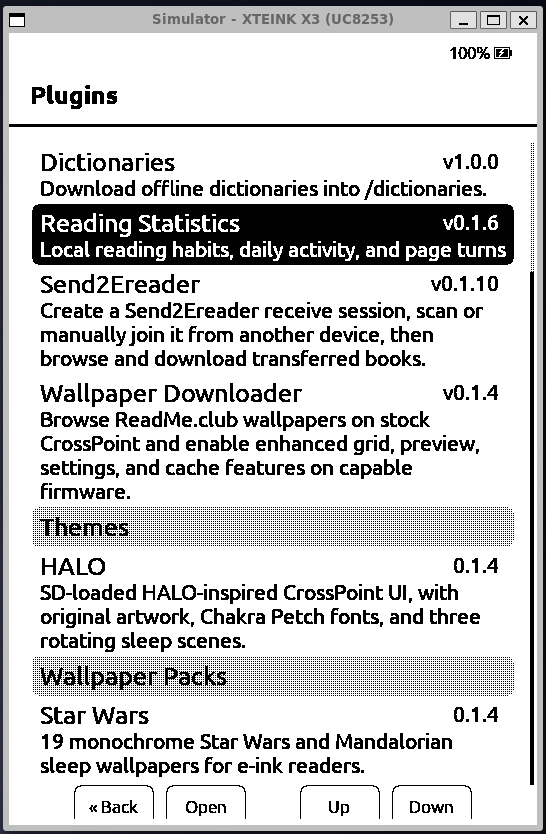
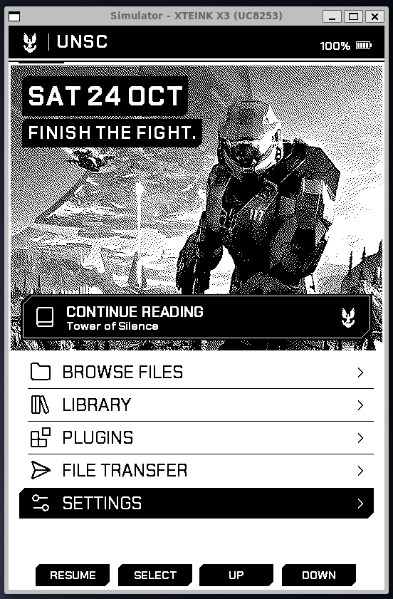
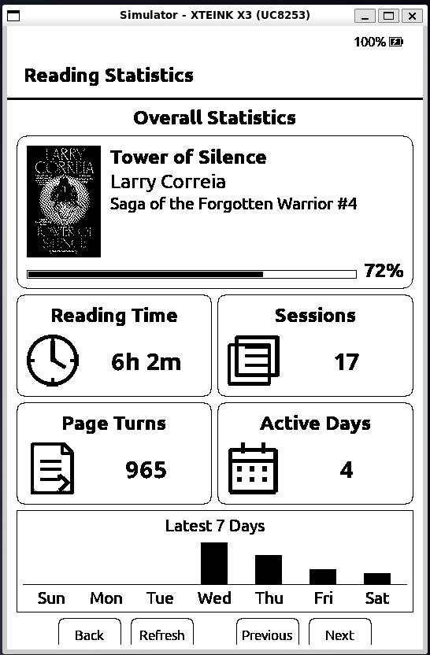
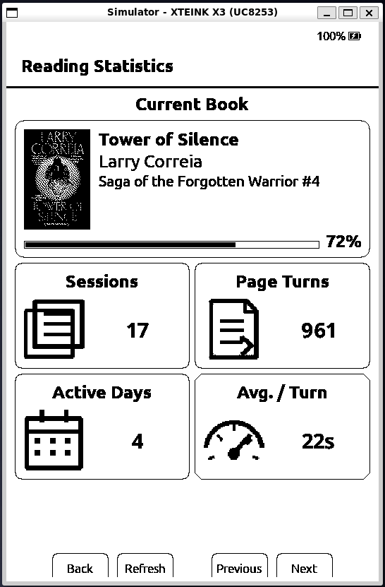
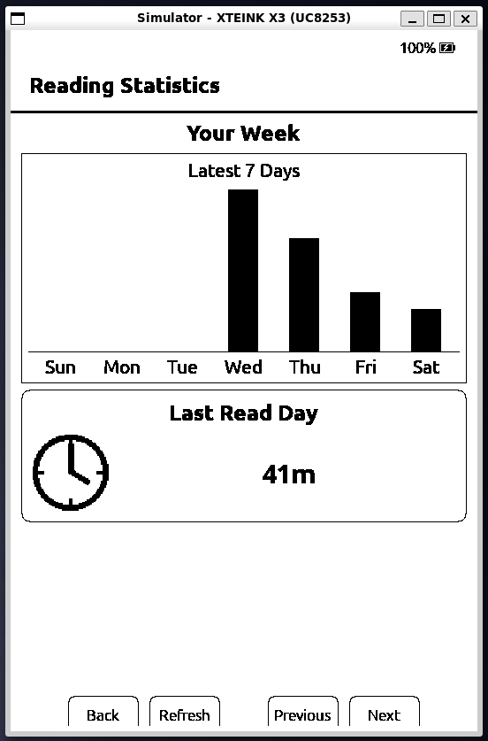
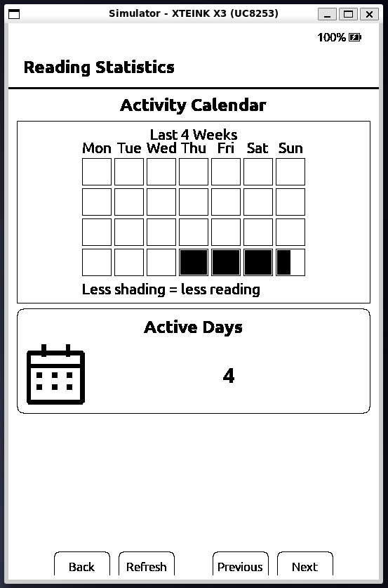
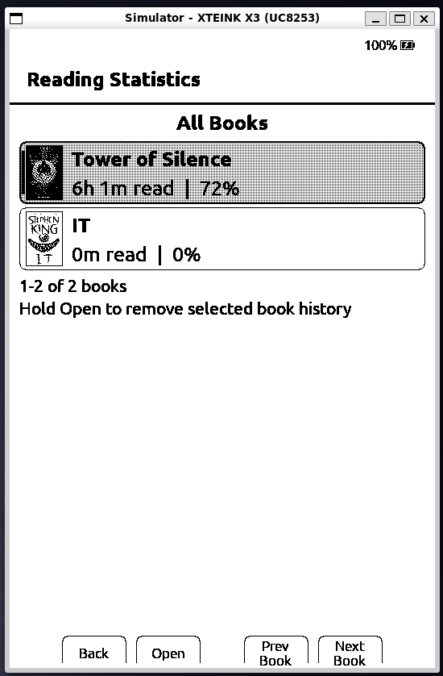
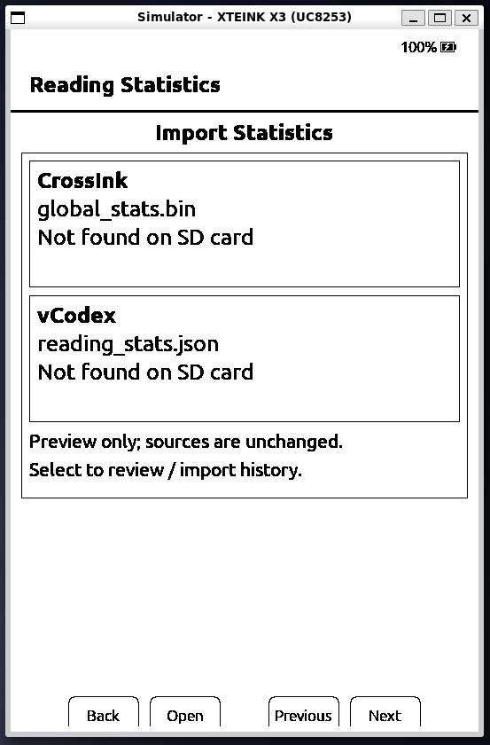

# Razor-Crest


**A personal fork of [CrossPoint Reader](https://github.com/crosspoint-reader/crosspoint-reader), built around a more customizable e-reader.**

Razor-Crest keeps CrossPoint's reading experience and adds a growing ecosystem of **on-device plugins, downloadable UI themes, wallpaper collections, native reading statistics, and customizable sleep screens**. The goal is to make these additions usable directly on the reader, including on the memory-constrained X3.

**Developed and maintained by [Jadehawk / Techy-Notes](https://techy-notes.com).** I also originally developed [Plugin Hub](https://github.com/crosspoint-reader/crosspoint-plugin-hub) and continue to maintain it now that it is hosted as an **official CrossPoint project**. Plugin Hub itself is firmware-agnostic; Razor-Crest is my personal firmware fork.

[**Watch the demo playlist**](https://www.youtube.com/playlist?list=PLEZP8Igz2ssw) · [**Browse firmware releases**](https://github.com/jadehawk/Razor-Crest/releases) · [**Explore the extension contracts**](docs/sd-extension-contracts.md)

> [!IMPORTANT]
> **This is a personal, unofficial CrossPoint fork—not an upstream CrossPoint release.** The features below describe the current `razor-crest` development branch. **Published firmware releases can lag behind it**; check the release date and notes before assuming a feature is included in a downloadable binary.
>
> Plugins should remain **firmware-agnostic**. A plugin, theme, or wallpaper pack declares the firmware capabilities it needs; it should not require the name `Razor-Crest`. Stock CrossPoint does not currently implement this fork's SD-theme or standalone wallpaper-pack loaders.

## Project philosophy: stay close to CrossPoint

**The goal is not to create a completely different firmware.** I want Razor-Crest to remain as close as practical to the original CrossPoint firmware, retain upstream fixes and device compatibility, and avoid permanently maintaining a large, divergent codebase.

Where possible, new functionality should live in **standalone plugins, themes, or wallpaper packs**, using small, reusable firmware capabilities rather than hard-coded integrations. That lets extensions work with any firmware that exposes the required features, not just Razor-Crest.

Razor-Crest also serves as a place to develop and test ideas. **My hope is that, over time, useful changes and extension primitives can be proposed upstream and—if accepted—become part of official CrossPoint.** Ideally, users will eventually be able to install the same plugins, themes, and packs on stock CrossPoint without needing this fork. Upstream acceptance is entirely up to the CrossPoint maintainers.

## Screenshots

A look at Razor-Crest's installed plugins, HALO theme, and native Reading Statistics dashboard. **The HALO appearance is based on [IOSDEC's original CrossPoint HALO project](https://github.com/iosdec/crosspoint-halo).** Click any screenshot to open the full-size image.

### Plugins and themes

| Plugins screen | HALO theme |
| :---: | :---: |
| <a href="docs/images/razor-crest/plugins-page.png"></a> | <a href="docs/images/razor-crest/halo-theme.png"></a> |

### Reading Statistics

Six views of the native, on-device statistics dashboard:

| Page 1 | Page 2 | Page 3 |
| :---: | :---: | :---: |
| <a href="docs/images/razor-crest/reading-stats-01.png"></a> | <a href="docs/images/razor-crest/reading-stats-02.png"></a> | <a href="docs/images/razor-crest/reading-stats-03.png"></a> |
| **Page 4** | **Page 5** | **Page 6** |
| <a href="docs/images/razor-crest/reading-stats-04.png"></a> | <a href="docs/images/razor-crest/reading-stats-05.png"></a> | <a href="docs/images/razor-crest/reading-stats-06.png"></a> |

## What Razor-Crest Adds to CrossPoint

Razor-Crest retains the original CrossPoint reading experience while introducing additional customization, statistics, and plugin capabilities not currently included in stock CrossPoint firmware.

- **Installable UI Themes** — Customize the reader's interface, including the home screen, headers, settings, artwork, and compatible UI fonts. Install or switch themes without reflashing firmware. Includes support for the [HALO theme](https://github.com/jadehawk/halo.crosspoint-theme), inspired by [IOSDEC's original CrossPoint HALO](https://github.com/iosdec/crosspoint-halo).
- **Standalone Wallpaper Packs** — Install and manage complete wallpaper collections directly from Plugin Hub. Select individual collections for the sleep screen, independently of the active UI theme.
- **Timed Sleep-Screen Refresh** — Automatically rotate wallpapers while the reader is asleep, with configurable intervals ranging from 1 minute to 24 hours. Includes device-specific wake handling and battery-consumption warnings on the X3.
- **Native Reading Statistics** — Collect persistent reading activity directly on the device, including reading time, sessions, and qualified page turns. Statistics are stored locally on the SD card and do not require Wi-Fi or an external server.
- **On-Device Reading Statistics Dashboard** — Explore reading history through a six-page dashboard with statistics cards, weekly activity charts, a 28-day calendar, book covers, and detailed statistics for individual books.
- **Live Reading Statistics Sleep Screen** — Display a personalized reading dashboard instead of a traditional sleep wallpaper. Supported timed refreshes can update the statistics display without connecting to Wi-Fi.
- **Reading Statistics Import** — Import supported historical reading statistics from CrossInk and vCodex, preserving original records and preventing duplicate imports.
- **Enhanced Plugin Catalog Browsing** — Additional image previews, visual catalog layouts, cached content, and refresh controls for discovering and managing supported extensions.
- **Dedicated Plugin Management Web UI** — Manage every installed plugin from a separate Plugins page, including plugins without browser-based settings. View plugin details and use Reinstall or Remove controls.
- **Improved KOReader Sync Interface** — Compare local and remote reading positions using visual progress cards showing percentages, pages, chapters, and device information before choosing which position to keep.
- **Optional Techy-Notes LCP Integration** — Support an alternative LCP enrollment service through Techy-Notes when the firmware is configured with the necessary enrollment credentials.

These are **Razor-Crest additions**, not a claim that the underlying Plugin System, Plugin Hub, standard plugin installation, KOReader progress sync, or the merged static-catalog pagination fix are exclusive to this fork. Plugins such as [Wallpaper Downloader](https://github.com/jadehawk/wallpapers.crosspoint-plugin) and [Send2Ereader](https://github.com/jadehawk/send2ereader.crosspoint-plugin) remain separate, capability-based projects that can work with other compatible firmware.

## See it in action

The [Razor-Crest YouTube playlist](https://www.youtube.com/playlist?list=PLEZP8Igz2ssw) is deliberately arranged as a walkthrough: **install first, explore the results next**. Each image is a clickable YouTube preview. Playing a video with its playlist link preserves the sequence.

| In playlist order | Video demo |
| --- | --- |
| **1. Install plugins, themes, and packs**<br>Enable the plugin system and use the on-device catalog to add extensions. | <a href="https://www.youtube.com/watch?v=aG037VmTO5E&amp;list=PLEZP8Igz2ssw&amp;index=1"></a> |
| **2. Reading Statistics overview**<br>Browse the offline reading dashboard and per-book information. | <a href="https://www.youtube.com/watch?v=3cCaplvtFcY&amp;list=PLEZP8Igz2ssw&amp;index=2"></a> |
| **3. Reading Statistics sleep screen**<br>Use the live dashboard as a custom sleep-screen source. | <a href="https://www.youtube.com/watch?v=UPD7VzZ3orI&amp;list=PLEZP8Igz2ssw&amp;index=3"></a> |
| **4. Sleep-screen wallpaper packs**<br>Select an installed collection for Custom sleep. | <a href="https://www.youtube.com/watch?v=FmqKx7wb4OU&amp;list=PLEZP8Igz2ssw&amp;index=4"></a> |
| **5. Wallpaper downloader plugin**<br>Browse and save additional wallpapers on the device. | <a href="https://www.youtube.com/watch?v=ddZdS-gFEOo&amp;list=PLEZP8Igz2ssw&amp;index=5"></a> |
| **6. HALO theme**<br>See a complete UI appearance change, not just a sleep wallpaper. | <a href="https://www.youtube.com/watch?v=j0IXO0eukL4&amp;list=PLEZP8Igz2ssw&amp;index=6"></a> |
| **7. Send2Ereader**<br>See an example of a functional plugin that goes beyond visual customization. | <a href="https://www.youtube.com/watch?v=8MzyZ73z02g&amp;list=PLEZP8Igz2ssw&amp;index=7"></a> |

## What's different in Razor-Crest?

### 1. Extensions you can install from the reader

The **Plugin System** is enabled under **Settings → Connectivity → Plugins**. When enabled, **Home → Plugins** lists the installed extensions. If Plugin Hub is missing, the firmware offers to download it; Plugin Hub itself remains optional for manually installed plugins.

From there, the capability-aware Community catalog can present compatible extensions by type:

| Extension type | What it does | Examples |
| --- | --- | --- |
| **Plugins** | Add on-device catalogs, dashboards, network workflows, or browser-side features without reflashing the firmware. | [Reading Statistics](https://github.com/jadehawk/reading-statistics.crosspoint-plugin), [Wallpapers](https://github.com/jadehawk/wallpapers.crosspoint-plugin), [Send2Ereader](https://github.com/jadehawk/send2ereader.crosspoint-plugin) |
| **Themes** | Change the appearance of supported firmware screens: layouts, headers, artwork, and compatible UI fonts. | [HALO theme](https://github.com/jadehawk/halo.crosspoint-theme) |
| **Wallpaper packs** | Supply named, device-resolution-compatible BMP collections for Custom sleep screens. These are independent of UI themes. | [Star Wars wallpaper collections](https://github.com/jadehawk/starwars.crosspoint-wallpaper) |

The native installer uses declared package contents and staged updates, with compatibility filtering. Installed extensions can display update status and be managed from the reader. A press-and-hold on a plugin entry offers uninstall with confirmation; active themes must be deselected before removal.

**[Watch demo 1: Installing plugins, themes, and packs](https://www.youtube.com/watch?v=aG037VmTO5E&list=PLEZP8Igz2ssw&index=1)**

### 2. Native, offline Reading Statistics

Razor-Crest records native reading activity to compact binary files on the SD card—even if plugins are disabled. With the [Reading Statistics plugin](https://github.com/jadehawk/reading-statistics.crosspoint-plugin) installed, you can view a styled on-device dashboard with:

- Overall and current-book statistics, reading time, sessions, and qualified forward page turns.
- Recent activity visualizations, including weekly bars and a 28-day history grid.
- An **All Books** view with saved cover thumbnails, titles, authors, progress, and per-book detail pages.
- An optional, reviewed import of supported **CrossInk** or **vCodex** legacy reading statistics. Original files are preserved and previously imported records are not silently duplicated.

Collection and display are local; the native dashboard does **not** require a cloud account, external statistics server, or Wi-Fi. Native statistics and the dashboard integration are still a **development V1 contract**, not a promise of compatibility with every CrossPoint build.

**[Watch demo 2: Reading Statistics overview](https://www.youtube.com/watch?v=3cCaplvtFcY&list=PLEZP8Igz2ssw&index=2)** · [Technical details](docs/reading-stats-plugin-architecture.md)

### 3. A live statistics sleep screen

With Reading Statistics installed and enabled, **Settings → Display → Sleep Screen → Custom → Wallpaper Collection** can offer **Reading Statistics** as a virtual source. Instead of an image file, the firmware draws the latest overview using locally saved reading data whenever the device enters Custom sleep.

The display has no dashboard navigation controls. On supported timed refresh, the overview can be redrawn on a timer wake **without starting Wi-Fi**. If the plugin is unavailable, the selector falls back to regular wallpapers.

**[Watch demo 3: Reading Statistics on the sleep screen](https://www.youtube.com/watch?v=UPD7VzZ3orI&list=PLEZP8Igz2ssw&index=3)**

### 4. Wallpaper collections and timed sleep refresh

Custom sleep screens can use **All wallpapers** (the combined `/.sleep` and `/sleep` folders) or a named, installed wallpaper pack. The **Wallpaper Collection** selector appears when you choose Custom sleep; collections are resolution-aware, and the chosen collection stays separate from your UI theme.

**Timed Sleep-Screen Refresh** can rotate locally saved wallpaper images while the reader remains asleep. The current menu offers **Off, 1 minute, 15 minutes, 30 minutes, 1 hour, 3 hours, 6 hours, 12 hours, and 24 hours**. Timer wakes perform SD/display work and return to deep sleep—not background plugin jobs or internet downloads. On X3, the firmware displays a battery-use warning; actual drain depends on the interval and hardware.

The separate [Wallpapers plugin](https://github.com/jadehawk/wallpapers.crosspoint-plugin) can browse image catalogs, preview/download wallpapers, and reuse an optional SD cache. A wallpaper **plugin** downloads images; a wallpaper **pack** is an installable collection for sleep-screen selection.

**[Watch demo 4: Wallpaper packs](https://www.youtube.com/watch?v=FmqKx7wb4OU&list=PLEZP8Igz2ssw&index=4)** · **[Watch demo 5: Wallpaper plugin](https://www.youtube.com/watch?v=ddZdS-gFEOo&list=PLEZP8Igz2ssw&index=5)**

[Timed wake testing](docs/timed-wake-testing.md) · [X3 battery measurements](docs/x3-timed-refresh-battery.md)

### 5. Full SD-card UI themes

Themes can customize supported headers, home screens, settings/library presentation, boot/sleep artwork, layout metrics, and validated monochrome UI fonts. They are **declarative appearance packages**, not executable plugins, and cannot change firmware reading/navigation behavior.

[HALO](https://github.com/jadehawk/halo.crosspoint-theme) demonstrates these capabilities across supported devices. The firmware validates the theme package and falls back to its built-in appearance if a theme is unavailable or invalid.

**Original HALO design credit: [IOSDEC — CrossPoint HALO](https://github.com/iosdec/crosspoint-halo).** The installable HALO theme adapts the look of IOSDEC's original firmware project for Razor-Crest's SD-card theme system.

**[Watch demo 6: HALO theme](https://www.youtube.com/watch?v=j0IXO0eukL4&list=PLEZP8Igz2ssw&index=6)** · [Theme contract](https://github.com/jadehawk/halo.crosspoint-theme/blob/main/docs/THEME_CONTRACT.md)

### 6. Useful plugins, not only appearance changes

[Send2Ereader](https://github.com/jadehawk/send2ereader.crosspoint-plugin) illustrates how an extension can provide a connected workflow without hardcoding a particular service into the firmware. Browser-based plugins can also expose settings or actions in the device Web UI; native on-device plugins use the firmware's declared capabilities.

**[Watch demo 7: Send2Ereader](https://www.youtube.com/watch?v=8MzyZ73z02g&list=PLEZP8Igz2ssw&index=7)**

## Install Razor-Crest

1. Open [**Razor-Crest Releases**](https://github.com/jadehawk/Razor-Crest/releases) and check the **release notes** and the asset for your exact device. Not every feature visible in the development demos will necessarily be in the latest published release.
2. Connect the reader with a data-capable USB cable, then open the [CrossPoint web flash tools](https://crosspointreader.com/#flash-tools).
3. Select the **correct device** and use **Custom .bin** to flash the downloaded Razor-Crest binary. Do not choose an official upstream release when intending to install this fork.
4. After flashing, enable **Settings → Connectivity → Plugins** if you want plugins and Plugin Hub. New installations default to disabled; existing plugin setups are preserved on upgrade.

The fork's release workflow covers the upstream release device matrix, including X3/X4, X4 Pro, X4 Classic, Seeed reTerminal Sticky, Paper Mono, MetalIO EInk4, and EEGO A4. **Check the individual release assets** for actual availability and device naming; a listed build target is not a claim that every extension has been hardware-validated on that model. Use the firmware file built for your board only.

> [!CAUTION]
> Some USB-locked Xteink devices have special recovery restrictions. The upstream [Xteink Unlocker](https://crosspointreader.com/#unlock-tool) officially supports **CrossPoint and CrossInk**, not arbitrary forks. Flashing an unsupported image to a device that is re-locked can make it unrecoverable. Understand your device's unlock/recovery state before attempting to install Razor-Crest.

### Install plugins, themes, and wallpaper packs

1. Enable the Plugin System at **Settings → Connectivity → Plugins**, then open **Home → Plugins**.
2. Choose **Plugin Hub**. If it is not installed, use the built-in installer while connected to Wi-Fi.
3. In Plugin Hub, browse the available **compatible** community extensions, select an item, inspect its details, and install it. The catalog only shows theme/wallpaper types when firmware advertises the necessary capabilities.
4. Activate a theme from the firmware's theme selection controls, or choose **Settings → Display → Sleep Screen → Custom → Wallpaper Collection** for a wallpaper pack. Plugins appear under **Home → Plugins**.

Plugin Hub is not required for manual installation. See [SD-card plugins](docs/sd-plugins.md) and [SD extension packages](docs/sd-extension-contracts.md) for the accepted package roots and formats.

## What you still get from CrossPoint

Razor-Crest builds on the ongoing work of the upstream [CrossPoint Reader](https://github.com/crosspoint-reader/crosspoint-reader) project: EPUB and other supported book formats, bookmarks and highlights, dictionary lookups, library browsing, wireless file transfer, OPDS, KOReader-compatible progress sync, device-specific controls, custom fonts, and the reader's existing web interface. These upstream features continue to evolve; see the [CrossPoint README](https://github.com/crosspoint-reader/crosspoint-reader#readme) and this repository's [User Guide](USER_GUIDE.md) for the complete baseline documentation.

This fork also maintains the firmware identity `Razor-Crest` while keeping the shared `crosspoint` firmware family and plugin API compatibility. Extensions should discover `pluginCapabilities` from `/api/status` rather than checking fork branding.

## Related Techy-Notes projects

Razor-Crest is one part of a broader set of reader tools and services that I develop or maintain. Most are independent of the fork and can be used with compatible CrossPoint or KOReader devices.

| Project | What it provides |
| --- | --- |
| **[Plugin Hub](https://github.com/crosspoint-reader/crosspoint-plugin-hub)** | **Originally created and still maintained by Jadehawk.** Now an **official CrossPoint-hosted project**, it discovers, installs, updates, and manages SD-card extensions. Its catalog is capability-based, not locked to Razor-Crest. |
| [Reading Statistics](https://github.com/jadehawk/reading-statistics.crosspoint-plugin) | An on-device, offline dashboard for reading activity, book history, and supported statistics imports. |
| [Wallpaper Downloader](https://github.com/jadehawk/wallpapers.crosspoint-plugin) | Browse, preview, cache, and download images for the reader. |
| [HALO theme](https://github.com/jadehawk/halo.crosspoint-theme) | Installable declarative UI theme inspired by [IOSDEC's original CrossPoint HALO](https://github.com/iosdec/crosspoint-halo). |
| [Star Wars wallpaper packs](https://github.com/jadehawk/starwars.crosspoint-wallpaper) | Installable collections of sleep-screen wallpapers with device-appropriate image variants. |
| [Send2Ereader for CrossPoint](https://github.com/jadehawk/send2ereader.crosspoint-plugin) | An on-device plugin for transferring books through a compatible Send2Ereader service. |
| [Send2Ereader for KOReader](https://github.com/jadehawk/send2ereader.koplugin) | A companion KOReader plugin for sending, browsing, and receiving books using session codes or QR codes. |
| [Deluxe-Sync for KOReader](https://github.com/jadehawk/deluxe-sync.koplugin) | A separate KOReader plugin that supports progress sync with multiple KOSync-compatible servers, including the Techy-Notes service. |

### Complimentary compatible servers

I also operate optional services under [Techy-Notes.com](https://techy-notes.com) that work with supported CrossPoint devices. **Neither server is required to use Razor-Crest**; they are independent of the firmware, and you can choose other compatible services or self-host.

- **[Techy-Notes Sync Server](https://sync.techy-notes.com)** — a CrossPoint/KOReader-compatible progress-sync service. Configure it as a custom sync server under **Settings → Connectivity → CrossPoint Sync** to synchronize reading progress across compatible devices. It also supports enhanced metadata and library features for clients that understand them. This is an alternative to, not a replacement for, CrossPoint's official sync server.
- **[Techy-Notes Send2Ereader Server](https://send.techy-notes.com)** — a book-transfer service for compatible Send2Ereader clients, including the CrossPoint and KOReader plugins linked above. Create or join a transfer session, then share books through its session code or QR workflow. This transfers books; it does **not** synchronize reading positions.

The servers, the Plugin Hub catalog, and the downloadable packages are deliberately kept outside the core reading firmware wherever possible.

## For extension authors and contributors

Want to build your own plugin, theme, or wallpaper pack? The formats are intentionally separate and capability-gated:

- [**Plugin Hub extension creation and publishing guide**](https://github.com/crosspoint-reader/crosspoint-plugin-hub/blob/main/docs/BUILD_AND_PUBLISH_EXTENSIONS.md) — authoring, catalog eligibility, and publication.
- [**SD-card plugin contract**](docs/sd-plugins.md) — on-device `device.json` catalogs, browser-side plugins, networking, and events.
- [**Theme and wallpaper package contracts**](docs/sd-extension-contracts.md) — package structure, runtime capabilities, validation, and compatibility.
- [**HALO theme reference**](https://github.com/jadehawk/halo.crosspoint-theme/blob/main/docs/THEME_CONTRACT.md) and [**Star Wars wallpaper reference**](https://github.com/jadehawk/starwars.crosspoint-wallpaper/blob/main/docs/WALLPAPER_PACK_CONTRACT.md) — independent examples and AI-assisted authoring instructions.

For firmware development, clone **this fork**, not the upstream repository:

```sh
git clone --recursive https://github.com/jadehawk/Razor-Crest.git
```

See [contributing guidance](docs/contributing/README.md), [project scope](SCOPE.md), [device/user guide](USER_GUIDE.md), and [firmware testing notes](docs/timed-wake-testing.md). The branch `razor-crest` contains the fork's customizations; the `develop` branch tracks upstream development.

## Credits

**Razor-Crest exists because of [CrossPoint Reader](https://github.com/crosspoint-reader/crosspoint-reader), [FreeInk SDK](https://github.com/Free-Ink/freeink-sdk), and their contributors.** This personal fork is developed by [Jadehawk](https://github.com/jadehawk), original developer and ongoing maintainer of the now official [Plugin Hub](https://github.com/crosspoint-reader/crosspoint-plugin-hub). **The HALO visual design originates with [IOSDEC's CrossPoint HALO](https://github.com/iosdec/crosspoint-halo)** and is credited here as the inspiration for our installable theme. Other plugin/theme/pack authors retain credit in their own repositories.

Razor-Crest is **not affiliated with Xteink or any device manufacturer** and is **not an official CrossPoint firmware distribution**.

## Follow and support Techy-Notes

If you find these projects useful, you can follow the demos and tutorials, read more about the projects, or support their continued development:

- **[Techy-Notes.com](https://techy-notes.com)** — project news, guides, and tutorials.
- **[YouTube — Techy-Notes / Jadehawk](https://www.youtube.com/@jadehawk)** — videos, demonstrations, and walkthroughs, including the [Razor-Crest playlist](https://www.youtube.com/playlist?list=PLEZP8Igz2ssw).
- **[Buy Me a Coffee — Support Techy-Notes](https://buymeacoffee.com/jadehawk)** — optional support for independent development.
- **[GitHub — Jadehawk](https://github.com/jadehawk)** — source code and other projects.
